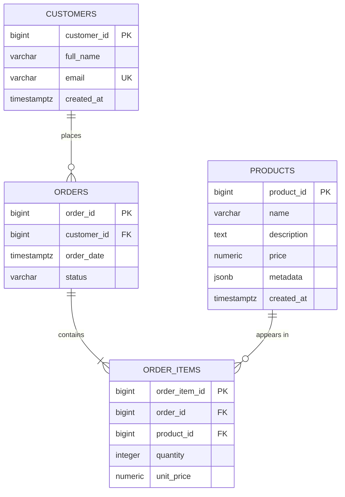

# E-Commerce Analytics Data Pipeline

PBEM04 Database Fundamentals lab.

A small back end for an online shop. PostgreSQL stores customers, products and
orders, Redis caches the top 10 best-selling products, and MongoDB keeps
shopping carts. SQL reports use CTEs and window functions, and indexes are
checked with `EXPLAIN ANALYZE`.

## Tech stack

Python 3.11+, PostgreSQL 17, Redis 7, MongoDB 8, Docker Compose, psycopg2,
redis-py, pymongo, pytest.

## Database design



### Schema

- `customers`: one row per customer. Email is required and unique.
- `products`: the catalogue. Price is `NUMERIC` and cannot be negative.
  Attributes that differ between product types (sizes, colors, ports) are
  stored in the `metadata` JSONB column.
- `orders`: one purchase by a customer. Status must be one of `pending`,
  `paid`, `shipped`, `delivered` or `cancelled`.
- `order_items`: the products in an order. Quantity must be positive and a
  product can appear only once per order.

Customers and products that are still referenced cannot be deleted, and
deleting an order deletes its items.

The schema is in third normal form. Order items are separate rows instead of
a list inside `orders`, quantity and price belong to the order item, and
orders store only `customer_id` instead of repeating customer details.
`order_items.unit_price` keeps the price paid at the time of purchase, so old
orders stay correct when a product's price changes.

More detail: [docs/database-design.md](docs/database-design.md).

## Setup

You need Python 3.11+ and Docker Desktop.

```powershell
python -m venv .venv
.venv\Scripts\activate
pip install -r requirements-dev.txt

copy .env.example .env      # then set your own passwords
docker compose up -d

python scripts/setup_database.py     # tables and indexes
python scripts/load_sample_data.py   # sample data
```

`.env.example` lists every setting. If another project already uses ports
5432, 6379 or 27017, change `POSTGRES_PORT`, `REDIS_PORT` and `MONGO_PORT`
(and the port in `MONGO_URI`) in `.env`.

## Running

The easiest way to try everything is the console shop:

```powershell
python scripts/demo.py
```

From the menu you can register, search products, add items to a cart,
check out, pay for an order, see the best sellers, view the sales reports
and compare query speed with and without indexes.

Other scripts:

| Command | Purpose |
|---|---|
| `python scripts/run_analytics.py` | Sales reports and query plans |
| `python scripts/run_top_products.py` | Shows a cache miss, then a cache hit |
| `python scripts/run_benchmark.py --load` | Loads a large dataset and measures the indexes |
| `python scripts/run_benchmark.py --remove` | Removes the large dataset |

## How the main parts work

- Orders: `create_order()` saves an order and its items in one transaction.
  If anything fails, nothing is saved. All queries use parameters, so input
  can never run as SQL.
- Revenue: only `paid`, `shipped` and `delivered` orders count.
- Redis: the top 10 list is cached for 5 minutes and cleared when an order is
  paid or cancelled. If Redis is down, results come from PostgreSQL.
- MongoDB: each customer has one active cart. Carts left untouched for 24
  hours are deleted automatically. Checkout turns the cart into a PostgreSQL
  order.
- Reports: revenue per customer and product ranking use CTEs and `RANK()`
  ([sql/02](sql/02_customer_revenue.sql), [sql/03](sql/03_product_ranking.sql),
  [sql/04](sql/04_monthly_revenue.sql)).

## Optimization results

Two indexes are created in [sql/05_indexes.sql](sql/05_indexes.sql): a B-tree
on `orders(customer_id)` and a GIN index on `products(metadata)`.

With the small sample data PostgreSQL still uses sequential scans, which is
expected for tiny tables. On a dataset of 200,000 orders and 50,000 products
(median of 7 runs):

| Query | Without index | With index |
|---|---|---|
| Orders for one customer | Seq Scan, 10.2 ms | Index Scan, 0.05 ms |
| Products by brand (JSONB) | Seq Scan, 12 to 16 ms | Bitmap Index Scan, 1 ms |

Full report with query plans:
[docs/optimization-report.md](docs/optimization-report.md).

## Tests

```powershell
pytest
pytest --cov=src/ecommerce
```

The tests need the Docker services running. Redis and MongoDB tests are
skipped if those services are not available.
