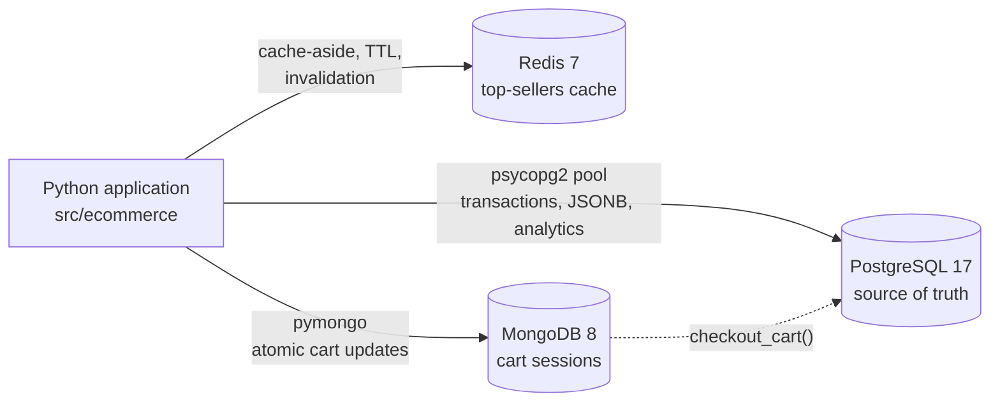
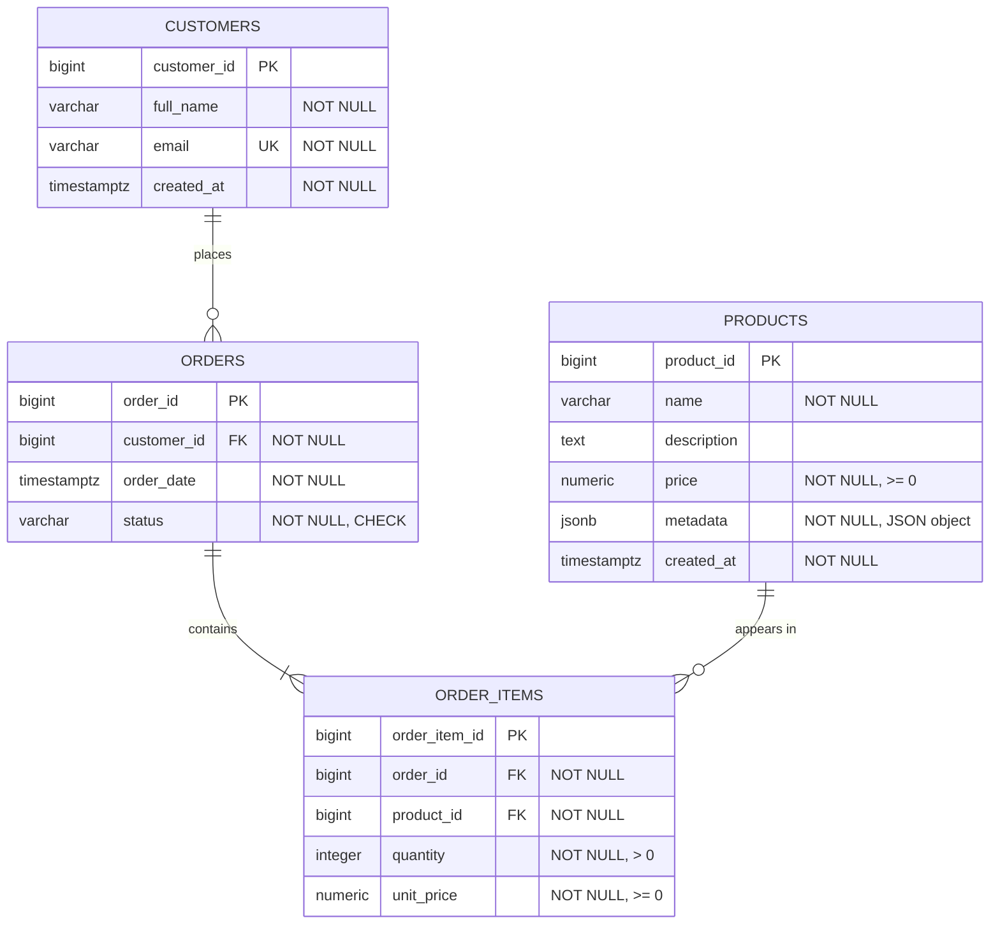

# E-Commerce Analytics Data Pipeline

A Python data pipeline for a fictional e-commerce store. PostgreSQL holds the
normalized transactional data, Redis caches the best-selling products, and
MongoDB stores shopping-cart sessions. Analytical SQL uses CTEs and window
functions, and query performance is measured with `EXPLAIN ANALYZE`.

Built for the **PBEM04 – Database Fundamentals** lab.

## Try it: interactive shop

After [setup](#setup), start the shop and use it like a customer:

```powershell
python scripts/demo.py
```

```text
 Account      1  Sign in or register
 Shop         2  Best sellers (Redis cache)
              3  Search products (JSONB metadata)
 Cart         4  Add item to cart        (MongoDB)
              5  View cart
              6  Change quantity / remove item
              7  Checkout                (cart -> PostgreSQL order)
 Orders       8  My orders
              9  Pay, cancel, ship, or deliver an order
 Admin       10  Add a new product
             11  Sales reports           (CTEs + RANK)
             12  Index performance check (EXPLAIN ANALYZE)
              0  Exit
```

Every option calls the project modules (`repository`, `cache`,
`cart_repository`, `checkout`, `analytics`); the app contains no SQL itself.

**Suggested walkthrough**

1. **Register** (option 1) with any email address.
2. **Search** (3) for `category=clothing sizes=M`, or `?ports` for products
   that have a `ports` attribute.
3. **Add to cart** (4) using a product ID from the results, then **view** (5)
   and **change** (6) the cart.
4. **Checkout** (7): the MongoDB cart becomes a PostgreSQL order in one
   transaction. **My orders** (8) shows it as `pending`.
5. **Pay** (9) for the order. It now counts as a sale, and the cached best
   sellers are cleared.
6. **Best sellers** (2) twice: the first request is rebuilt from PostgreSQL,
   the second is served from Redis in about 1 ms.
7. **Add a product** (10) with attributes such as `category=home colors=oak`.
8. **Sales reports** (11) and **index performance** (12). For a meaningful
   index comparison, load the benchmark data first:
   `python scripts/run_benchmark.py --load`.

Mistakes such as an unknown product ID, an invalid email, or checking out an
empty cart are explained without stopping the app.

## Contents

- [Try it: interactive shop](#try-it-interactive-shop)
- [Architecture](#architecture)
- [Project structure](#project-structure)
- [Database design](#database-design)
- [Setup](#setup)
- [Environment variables](#environment-variables)
- [Running the pipeline](#running-the-pipeline)
- [Example usage](#example-usage)
- [Features](#features)
- [Query optimization](#query-optimization)
- [Testing](#testing)
- [Development workflow](#development-workflow)
- [Troubleshooting](#troubleshooting)

## Architecture



| Store | Responsibility | Why this store |
|---|---|---|
| PostgreSQL | Customers, products, orders, order items, analytics | Relational integrity, ACID transactions, JSONB, SQL analytics |
| Redis | Top 10 best-selling products | Fast reads for an expensive aggregate that changes rarely |
| MongoDB | Shopping-cart sessions | Flexible, frequently updated documents that expire on their own |

PostgreSQL is the source of truth. Redis holds only derived data that can be
rebuilt, and a MongoDB cart becomes permanent only when checkout creates a
PostgreSQL order.

## Project structure

```text
├── docker-compose.yml        PostgreSQL, Redis, and MongoDB services
├── requirements.txt          Runtime dependencies (pinned)
├── requirements-dev.txt      Test and lint tools
├── docs/
│   ├── database-design.md    Entities, ER diagram, normalization decisions
│   └── optimization-report.md
├── sql/
│   ├── 01_schema.sql         DDL: tables, keys, constraints
│   ├── 02_customer_revenue.sql   CTEs + RANK(): revenue per customer
│   ├── 03_product_ranking.sql    CTEs + RANK(): product sales ranking
│   ├── 04_monthly_revenue.sql    Monthly revenue report
│   ├── 05_indexes.sql        B-tree and GIN indexes
│   ├── 06_top_selling_products.sql  Query behind the Redis cache
│   ├── 07_sample_data.sql    Sample data
│   ├── 08_benchmark_data.sql     Large benchmark dataset
│   └── 09_remove_benchmark_data.sql
├── scripts/                  Command-line entry points (see below)
├── src/ecommerce/
│   ├── database.py           Connection pool and safe connection handling
│   ├── repository.py         Product and order CRUD, JSONB queries
│   ├── analytics.py          Reports, EXPLAIN ANALYZE, benchmarks
│   ├── cache.py              Redis top-sellers cache
│   ├── mongodb.py            MongoDB client configuration
│   ├── cart_repository.py    Cart-session operations
│   └── checkout.py           MongoDB cart -> PostgreSQL order
└── tests/                    Unit and integration tests
```

## Database design



### Schema explanation

| Table | Purpose | Key constraints |
|---|---|---|
| `customers` | One row per customer | Identity PK; `email` NOT NULL and UNIQUE |
| `products` | Current catalogue | `price NUMERIC(12,2)` CHECK `>= 0`; `metadata JSONB` CHECK it is an object |
| `orders` | One purchase by a customer | FK to `customers` (`ON DELETE RESTRICT`); `status` CHECK in `pending, paid, shipped, delivered, cancelled` |
| `order_items` | Products within an order | FKs to `orders` (`CASCADE`) and `products` (`RESTRICT`); `quantity > 0`; UNIQUE `(order_id, product_id)` |

### Normalization (3NF)

- **1NF:** every column is atomic. An order's products are rows in
  `order_items`, not a list in `orders`.
- **2NF:** `quantity` and `unit_price` describe one product *in one order*, so
  they live in `order_items`, not in `orders` or `products`.
- **3NF:** no non-key column depends on another non-key column. Orders store
  only `customer_id`, not the customer's name or email.
- **Deliberate snapshot:** `order_items.unit_price` copies the product price at
  purchase time. This is not duplication: it records a different fact (the
  price paid), so past order totals stay correct when the catalogue price
  changes.
- **JSONB for variable attributes only:** sizes, colors, and ports differ by
  category, so they live in `products.metadata`. Keys, prices, and
  relationships stay in relational columns.
- **Monetary values** use `NUMERIC`, never floating point.

Full design notes: [docs/database-design.md](docs/database-design.md).

## Setup

### Prerequisites

- Python 3.11 or newer
- Docker Desktop (Docker Compose v2)
- Git and, for the pull-request workflow, the GitHub CLI (`gh`)

### Steps

```powershell
# 1. Clone and enter the project
git clone https://github.com/Aline-CROIRE/ecommerce-analytics-pipeline.git
cd ecommerce-analytics-pipeline

# 2. Create a virtual environment and install dependencies
python -m venv .venv
.venv\Scripts\activate            # macOS/Linux: source .venv/bin/activate
pip install -r requirements-dev.txt

# 3. Create your local configuration, then set your own passwords in .env
copy .env.example .env             # macOS/Linux: cp .env.example .env

# 4. Start PostgreSQL, Redis, and MongoDB, and wait until they are healthy
docker compose up -d
docker compose ps

# 5. Create the tables and indexes, then load sample data
python scripts/setup_database.py
python scripts/load_sample_data.py
```

`setup_database.py` and `load_sample_data.py` are safe to run more than once.

## Environment variables

All settings are read from `.env` (never committed). See
[.env.example](.env.example).

| Variable | Used by | Purpose |
|---|---|---|
| `POSTGRES_DB`, `POSTGRES_USER`, `POSTGRES_PASSWORD` | Docker, app | Database name and credentials |
| `POSTGRES_HOST`, `POSTGRES_PORT` | Docker, app | Connection address (default `localhost:5432`) |
| `REDIS_PASSWORD` | Docker, app | Redis password |
| `REDIS_HOST`, `REDIS_PORT` | Docker, app | Redis address (default `localhost:6379`) |
| `REDIS_URL` | app (optional) | Full Redis URL; overrides host, port, and password |
| `MONGO_INITDB_ROOT_USERNAME`, `MONGO_INITDB_ROOT_PASSWORD` | Docker | MongoDB root user |
| `MONGO_PORT` | Docker | MongoDB host port (default `27017`) |
| `MONGO_URI` | app | MongoDB connection string; its port must match `MONGO_PORT` |
| `MONGO_DATABASE` | app | MongoDB database name |

## Running the pipeline

| Command | What it does |
|---|---|
| `python scripts/demo.py` | Interactive shop for trying every feature (see [Try it](#try-it-interactive-shop)) |
| `python scripts/setup_database.py` | Applies `01_schema.sql` and `05_indexes.sql`, then lists tables and indexes |
| `python scripts/load_sample_data.py` | Loads `07_sample_data.sql` and prints row counts |
| `python scripts/run_analytics.py` | Runs the revenue and ranking reports and prints before/after query plans |
| `python scripts/run_top_products.py` | Live check: first request reads PostgreSQL, second is a Redis cache hit |
| `python scripts/run_benchmark.py --load` | Loads the 670k-row dataset and benchmarks the indexes |
| `python scripts/run_benchmark.py --remove` | Removes the benchmark dataset |

## Example usage

```python
from ecommerce.cache import create_redis_client, get_top_selling_products
from ecommerce.cart_repository import add_item, create_cart, ensure_cart_indexes
from ecommerce.checkout import checkout_cart
from ecommerce.database import create_pool
from ecommerce.mongodb import create_mongo_client, get_database
from ecommerce.repository import (
    add_product,
    create_order,
    find_products_by_metadata,
    get_customer_orders,
    update_order_status,
)

pool = create_pool()
redis_client = create_redis_client()
mongo_client = create_mongo_client()

try:
    # PostgreSQL: add a product with JSONB metadata and place an order.
    hoodie = add_product(
        pool,
        name="Hoodie",
        price="45.00",
        metadata={"category": "clothing", "sizes": ["M", "L"], "colors": ["grey"]},
        cache=redis_client,
    )
    order = create_order(
        pool, customer_id=1, items=[{"product_id": hoodie["product_id"], "quantity": 2}]
    )  # -> status "pending", total_amount Decimal("90.00")

    # Paying the order makes it revenue and clears the cached rankings.
    update_order_status(pool, order["order_id"], "paid", cache=redis_client)

    # JSONB: clothing available in size L.
    matches = find_products_by_metadata(pool, {"category": "clothing", "sizes": ["L"]})

    # Redis: the first call reads PostgreSQL; repeat calls are served from cache.
    top_10 = get_top_selling_products(pool, redis_client)

    # MongoDB: build a cart session and check it out into a PostgreSQL order.
    carts = get_database(mongo_client)["carts"]
    ensure_cart_indexes(carts)
    create_cart(carts, customer_id=2)
    add_item(carts, customer_id=2, product_id=hoodie["product_id"], quantity=1)
    cart_order = checkout_cart(carts, pool, customer_id=2)

    history = get_customer_orders(pool, customer_id=2)
finally:
    pool.closeall()
    redis_client.close()
    mongo_client.close()
```

The scripts add `src` to the import path themselves. To run the example from
the project root, use `set PYTHONPATH=src` (Windows) or `export PYTHONPATH=src`.

## Features

### PostgreSQL operations (psycopg2)

- **Connection pooling:** `create_pool()` builds a `ThreadedConnectionPool` from
  `.env`. `pooled_connection()` always returns the connection, rolls back any
  unfinished transaction, and discards broken connections.
- **CRUD:** `add_product()`, `create_order()`, `get_customer_orders()`, and
  `update_order_status()` in [repository.py](src/ecommerce/repository.py).
- **SQL injection prevention:** every value is passed as a `%s` parameter.
- **ACID order creation:** `create_order()` checks the customer, locks the
  products with `FOR SHARE`, inserts the order and its items, and commits once.
  Any error rolls everything back, so no partial order is ever saved.
- **Validation:** IDs, quantities, prices (finite, non-negative, two decimal
  places), names, and statuses are checked before touching the database.

### PostgreSQL JSONB

- `products.metadata` holds category-specific attributes such as `sizes`,
  `colors`, `ports`, and `brand`.
- `find_products_by_metadata(pool, {"sizes": ["M"]})` uses containment (`@>`).
- `find_products_with_attribute(pool, "sizes")` uses key-exists (`?`).
- Both operators are supported by the GIN index `idx_products_metadata_gin`.

### Redis caching

- `get_top_selling_products()` uses the **cache-aside** pattern: read the key
  `ecommerce:products:top-selling:<limit>`; on a miss, query PostgreSQL
  ([06_top_selling_products.sql](sql/06_top_selling_products.sql)), store JSON
  with a 300-second TTL, and return it.
- **Invalidation:** `update_order_status()` and `add_product()` accept
  `cache=` and clear cached rankings after their transaction commits.
  Pending orders are not sales, so `create_order()` cannot make the cache stale.
- **Failure handling:** if Redis is unavailable or holds corrupt data, results
  come from PostgreSQL and the request still succeeds.

### MongoDB cart sessions (pymongo)

- One document per cart session: `session_id`, `customer_id`, `items`
  (`product_id`, `quantity`), `status`, and timestamps.
- **Atomic updates:** `add_item()` uses `$inc`/`$push` with a retry for
  concurrent adds; `update_quantity()`, `remove_item()`, and `clear_cart()` use
  targeted updates.
- **Indexes:** a partial unique index allows one active cart per customer, and
  a **TTL index** deletes carts untouched for 24 hours.
- **Checkout:** `checkout_cart()` claims the cart atomically, creates the
  PostgreSQL order, and marks the cart `checked_out`. If the order fails, the
  cart is restored to `active`.

### Analytics (CTEs and window functions)

| Report | Techniques |
|---|---|
| [Revenue per customer](sql/02_customer_revenue.sql) | Two CTEs, `LEFT JOIN`, `COALESCE`, `RANK() OVER` |
| [Product ranking](sql/03_product_ranking.sql) | CTEs, `RANK() OVER` by units sold |
| [Monthly revenue](sql/04_monthly_revenue.sql) | CTE, `DATE_TRUNC` |

Revenue counts only `paid`, `shipped`, and `delivered` orders; `pending` and
`cancelled` orders are excluded. Customers and products with no sales still
appear, with zero totals.

## Query optimization

Indexes in [05_indexes.sql](sql/05_indexes.sql): a B-tree on
`orders(customer_id)` and a GIN index on `products(metadata)`.

On a 670,000-row benchmark (median of 7 `EXPLAIN ANALYZE` runs):

| Query | Without index | With index | Speedup |
|---|---|---|---:|
| Customer order history | Seq Scan, ~10 ms | Index Scan, ~0.05 ms | ~200× |
| Product metadata `@>` | Seq Scan, ~12–16 ms | Bitmap Index Scan, ~1 ms | ~13× |

On the small sample dataset PostgreSQL correctly keeps using sequential scans,
which is why a realistic dataset is used. Method, query plans, and discussion:
[docs/optimization-report.md](docs/optimization-report.md).

## Testing

```powershell
pytest                                   # all tests
pytest --cov=src/ecommerce --cov-report=term-missing
ruff check .
black --check .
```

- **Unit tests** cover validation, the connection pool, Redis cache behavior,
  cart operations, and checkout logic. Many use mocks and need no services.
- **Integration tests** run against the Docker services: CRUD, transaction
  rollback, historical prices, analytics rules, index usage, JSONB queries,
  cache invalidation, MongoDB carts, and end-to-end checkout.
- Redis and MongoDB integration tests are skipped automatically if those
  services are not reachable. PostgreSQL tests need the database running.
- Test data uses unique names and is removed after each test.

Current result: **152 passed, 98% coverage**.

## Development workflow

Each change is developed on a feature branch (`feature/…`, `fix/…`, `test/…`,
`docs/…`), opened as a pull request into `develop`, and merged after the tests
pass. `develop` is released to `main` through a final pull request. Commit
messages follow the Conventional Commits style (`feat:`, `fix:`, `test:`).

## Troubleshooting

**`password authentication failed` although `.env` is correct.**
Another local project is probably using the same host port, so you are
connecting to a different database. Check with `docker ps`; if another
container publishes `5432`, `6379`, or `27017`, set different ports in `.env`
(for example `POSTGRES_PORT=5433`, `REDIS_PORT=6380`, `MONGO_PORT=27018`,
and the same port in `MONGO_URI`), then run `docker compose up -d` again.

**Changed passwords are ignored.** PostgreSQL and MongoDB read their
credentials only when their data volume is first created. To start over
(this deletes local data): `docker compose down -v`, then `docker compose up -d`.
