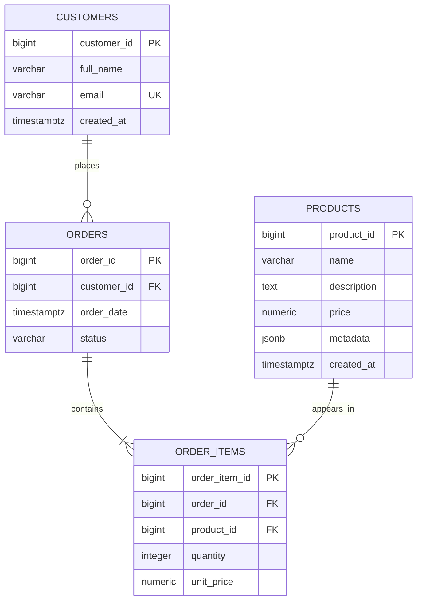

# Database Design: E-Commerce Analytics Pipeline

## 1. Purpose

This document describes the relational database design for the
E-Commerce Analytics Data Pipeline. The database uses PostgreSQL
to store customers, products, orders, and order items consistently
and support transactional operations and analytical queries.

## 2. Entities and Responsibilities

### Customers

Stores each customer's identity and contact information.

- `customer_id`: Primary key.
- `full_name`: Customer's name.
- `email`: Required and unique email address.
- `created_at`: Timestamp when the customer record was created.

### Products

Stores the current product catalogue and flexible product metadata.

- `product_id`: Primary key.
- `name`: Required product name.
- `description`: Optional product description.
- `price`: Current selling price, stored as a decimal monetary value.
- `metadata`: JSONB object for flexible attributes such as colour or size.
- `created_at`: Timestamp when the product record was created.

### Orders

Represents a purchase made by a customer.

- `order_id`: Primary key.
- `customer_id`: Foreign key referencing `customers`.
- `order_date`: Timestamp when the order was created.
- `status`: Current order status.

### Order Items

Represents a product included in a particular order.

- `order_item_id`: Primary key.
- `order_id`: Foreign key referencing `orders`.
- `product_id`: Foreign key referencing `products`.
- `quantity`: Number of units purchased; must be greater than zero.
- `unit_price`: Product price at the time of purchase.

The purchase-time price is stored separately from the current product
price so that historical order totals remain accurate when catalogue
prices change.

## 3. Entity Relationships

### Relationship explanations

- One customer can place many orders. Each order belongs to one customer.
- One order contains one or more order items.
- One product can appear in many order items.
- Each order item refers to one product.
- `order_items` resolves the many-to-many relationship between orders
  and products.

The diagram describes the intended business relationships. A foreign
key alone does not enforce that every order must contain at least one
item; that requirement must be handled through transaction logic or
additional database mechanisms.

## 4. Normalization Decisions

### First Normal Form (1NF)

Each column stores a single value rather than a repeating list of
values. Products in an order are represented by separate rows in
`order_items`, not by a comma-separated list in `orders`.

### Second Normal Form (2NF)

Every non-key attribute should depend on the whole candidate key.
The design gives each entity a primary key. In `order_items`, quantity
and purchase-time unit price describe the particular product entry in
an order, not the order or product independently.

### Third Normal Form (3NF)

Non-key attributes should depend on the key, the whole key, and nothing
but the key. Customer contact details belong in `customers`, product
catalogue details belong in `products`, and order details belong in
`orders`. Orders reference customers through `customer_id` rather than
duplicating customer names and email addresses.

These decisions reduce unnecessary duplication and help prevent
insertion, update, and deletion anomalies.

## 5. Integrity Rules

The schema in [`sql/01_schema.sql`](../sql/01_schema.sql) enforces:

- Every table has an identity primary key.
- Customer email addresses are required and unique.
- Required attributes use `NOT NULL`.
- Foreign keys protect relationships: deleting a customer or product that is
  still referenced is rejected (`ON DELETE RESTRICT`), and deleting an order
  removes its items (`ON DELETE CASCADE`).
- Product prices and historical unit prices cannot be negative.
- Order-item quantities must be positive.
- A product appears at most once per order (`UNIQUE (order_id, product_id)`);
  quantities are combined instead.
- Order status is limited to `pending`, `paid`, `shipped`, `delivered`, and
  `cancelled`.
- Product metadata must be a JSON object, not an array or scalar.
- Monetary values use PostgreSQL `NUMERIC`, not binary floating-point types.
- Order creation runs in one transaction (`create_order()` in
  `src/ecommerce/repository.py`), so an order and its items are saved together
  or not at all.

Rules that span rows are enforced in application code: an order must contain
at least one item, and every referenced customer and product must exist
before the order is written.

## 6. JSONB Decision

PostgreSQL JSONB stores flexible product metadata: attributes that vary by
category, such as `sizes` and `colors` for clothing or `ports` for electronics.

Core fields used for relationships, constraints, and calculations (keys,
names, and prices) remain in relational columns. JSONB is not a replacement
for the relational schema.

A GIN index on `metadata` supports the containment (`@>`) and key-exists (`?`)
queries used by `find_products_by_metadata()` and
`find_products_with_attribute()`. `category` is stored in JSONB in this
project; if it became a frequent filter, a relational column with a B-tree
index would give the planner better statistics.

## 7. Revenue Rules

Only orders with status `paid`, `shipped`, or `delivered` count as revenue.
`pending` orders are unpaid and `cancelled` orders never completed, so
both are excluded from the analytics reports and the top-sellers cache.

## 8. Performance

Indexes are defined in [`sql/05_indexes.sql`](../sql/05_indexes.sql) and applied
by `scripts/setup_database.py`:

- a B-tree index on `orders.customer_id` for customer order history;
- a GIN index on `products.metadata` for JSONB searches.

Their effect was measured with `EXPLAIN ANALYZE` on a 670,000-row benchmark
dataset. Method, query plans, and results are in the
[optimization report](optimization-report.md).
